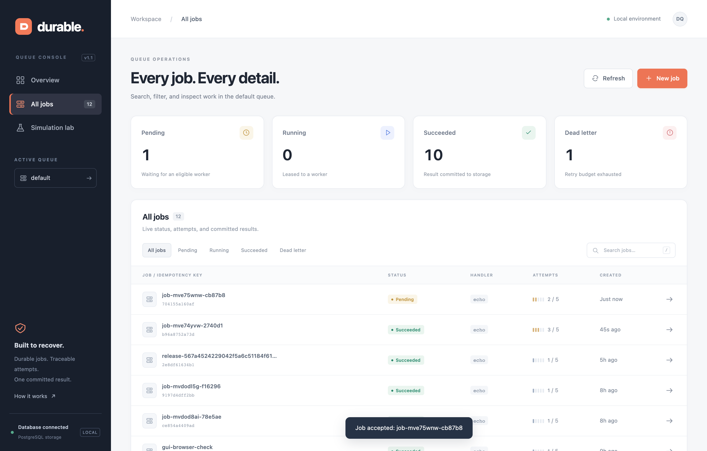
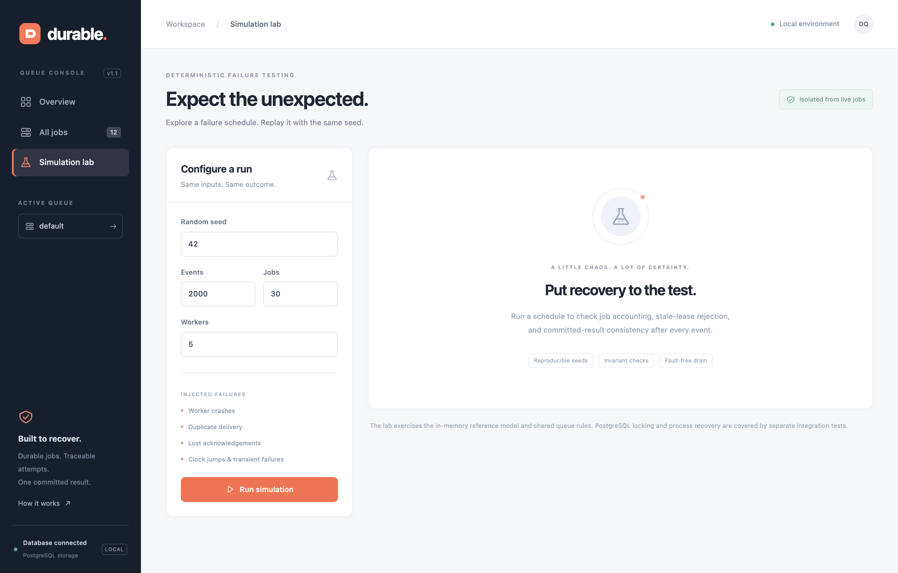
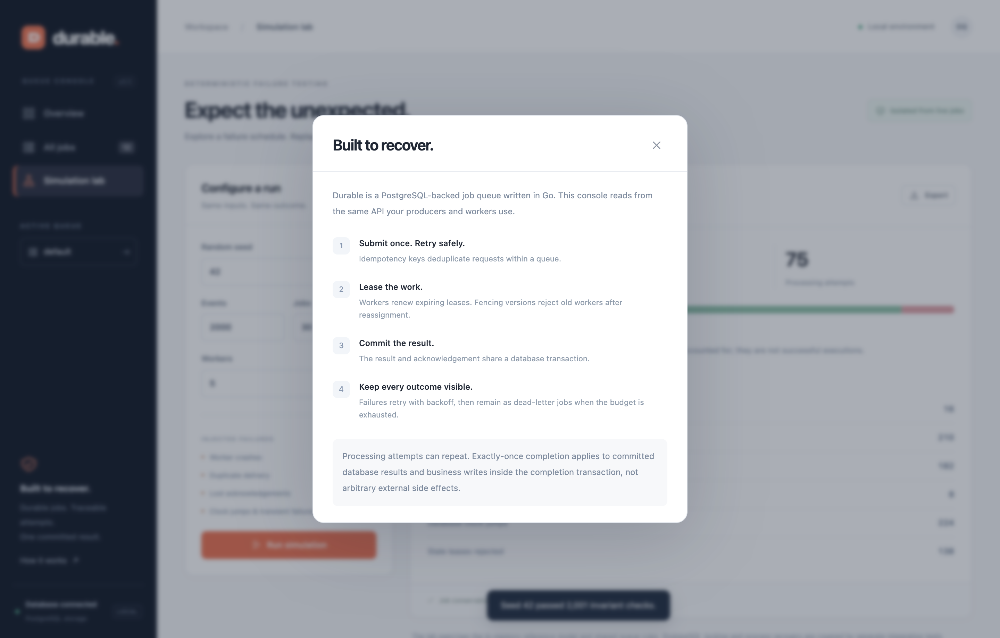

# Durable Job Queue — Visual Assets & Media Gallery

This directory contains high-resolution screenshots, video walkthroughs, and animated media demonstrating the **Durable Job Queue** operations console, job inspector, and deterministic simulation lab.

---

## 🎬 Video Recordings

All video assets are pre-rendered and optimized for different publication channels:

| Asset | Format | Resolution | Size | Best For | Link |
| :--- | :--- | :--- | :--- | :--- | :--- |
| **`durable_job_queue_demo.mp4`** | H.264 / MP4 | 1360 × 850 | ~882 KB | **LinkedIn video posts**, Twitter/X, GitHub release attachments | [View / Download](recordings/durable_job_queue_demo.mp4) |
| **`durable_job_queue_demo.gif`** | Animated GIF | 1080 × 675 | ~3.8 MB | **GitHub README embedding** (inline markdown preview) | [View / Download](recordings/durable_job_queue_demo.gif) |
| **`durable_queue_demo.webm`** | WebM / VP8 | 1360 × 850 | ~2.4 MB | High-fidelity master recording | [View / Download](recordings/durable_queue_demo.webm) |

### Video Walkthrough Highlights (42 seconds)
- **Overview Dashboard:** Real-time metrics for pending, running, succeeded, and dead-letter jobs with queue health distribution.
- **Job Creation & Presets:** Submitting jobs using presets (`echo`, `retry`, `slow`, `fail`), customized payload JSON, and client-generated idempotency keys.
- **Live Worker Processing:** Observing jobs transition from pending to succeeded with automatic backoff and attempt tracking.
- **Job Inspector:** Deep-dive into job metadata, fencing versions, attempt breakdown, payload, and committed transactional results.
- **Simulation Lab:** Seeded chaos injection with worker crashes, duplicate deliveries, clock jumps, and verifying 100% invariant passes.

---

## 📸 High-Resolution Screenshot Gallery

Captured on Retina display (`deviceScaleFactor: 2`, 2880 × 1840 viewport equivalent):

### 1. Operations Overview Console
> **File:** [`screenshots/01_dashboard_overview.png`](screenshots/01_dashboard_overview.png)
> 
> Displays real-time operational status, live counters for pending/running/succeeded/dead-letter jobs, queue health distribution bar, and recently processed jobs.

<p align="center">
  
</p>

---

### 2. Idempotent Job Submission Modal
> **File:** [`screenshots/02_create_job_modal.png`](screenshots/02_create_job_modal.png)
> 
> Interactive modal allowing developers to submit jobs with pre-configured templates (`Quick echo`, `Retry twice`, `Slow job`, `Failure`), customize JSON payloads, specify retry budgets, and test idempotency key deduplication.

<p align="center">
  
</p>

---

### 3. All Jobs Explorer & Filtering
> **File:** [`screenshots/03_all_jobs_view.png`](screenshots/03_all_jobs_view.png)
> 
> Paginated and searchable job table with status filter tabs (`All`, `Pending`, `Running`, `Succeeded`, `Dead letter`), execution attempt tracks, and handler tags.

<p align="center">
  
</p>

---

### 4. Job Inspector & Transactional Results Drawer
> **File:** [`screenshots/04_job_inspector_drawer.png`](screenshots/04_job_inspector_drawer.png)
> 
> Deep-dive drawer showing Job ID, idempotency key, retry attempts counter, lease version fencing token, previous error traces, full payload JSON, and committed transactional database result.

<p align="center">
  
</p>

---

### 5. Deterministic Failure Simulation Configuration
> **File:** [`screenshots/05_simulation_lab_config.png`](screenshots/05_simulation_lab_config.png)
> 
> The simulation test bench where engineers configure random seeds, event step counts, jobs, and worker concurrency to inject simulated faults into the queue model.

<p align="center">
  
</p>

---

### 6. Simulation Lab Results & Invariant Verification
> **File:** [`screenshots/06_simulation_lab_results.png`](screenshots/06_simulation_lab_results.png)
> 
> Detailed audit report generated after 2,000 chaos events showing **2,001 invariant checks passed** with zero violations across worker crashes, duplicate deliveries, clock jumps, and stale lease rejections.

<p align="center">
  
</p>

---

### 7. Architectural Guarantees Modal
> **File:** [`screenshots/07_architecture_modal.png`](screenshots/07_architecture_modal.png)
> 
> Educational modal explaining the four pillars of the queue: Idempotent Enqueueing, Expiring Leases, Atomic Transactional Completion, and Retained Dead-Letter accounting.

<p align="center">
  
</p>

---

## 🛠 How to Regenerate Media

All screenshots and videos can be regenerated automatically via the included Playwright automation script:

```bash
# Ensure the Docker Compose stack is running
docker compose up -d

# Run the automated capture and conversion script
node scripts/record_and_capture.js
```

This script drives Google Chrome headlessly, captures retina-scale screenshots, records the UI walkthrough, and runs `ffmpeg` to produce the MP4 and animated GIF assets.
